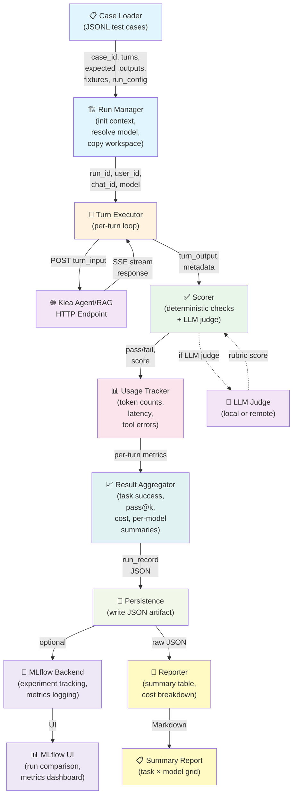

# Agent evaluation harness: planning note

Status: draft plan, not an ADR.  To be refined before implementation.
Companion to `agent-topology-literature-review.md`.  Written 2026-09-10 by
opencode (model: deepseek-flash).  The concrete `eval_pkg` implementation
plan is captured at the end of this document; it is deferred until the
general path stabilises.

## Why

The general-path topology must be chosen on evidence, and the scientific
write-up needs an evaluated comparison.  RAG was not evaluated this way; the
agent is harder because it carries out tasks rather than answering a single
query, so task success and cost are both first-class outcomes.  An evaluation
harness is therefore part of the architecture work, not an afterthought.

## Goals and non-goals

Goals:

- Compare candidate topologies (for example flat ReAct vs escalation ladder vs
  plan-first) on the same tasks, tools and models.
- Measure both correctness/task success and cost (tokens, LLM calls,
  wall-clock, notional money) under non-frontier models.
- Be reproducible and paper-ready: raw JSON plus generated summary tables.

Non-goals (first iteration):

- Full reproduction of GAIA/tau-bench/SWE-bench.  Start with a Klea-specific
  suite that mirrors their task shapes, and optionally add a public subset
  later.
- Multi-agent comparisons.  Out of scope per the literature review.

## What to measure

Per task run:

- task success (deterministic check where possible, LLM judge otherwise)
- pass@1 and pass^k over N repetitions (reliability)
- number of LLM calls, broken down by role
- input/output tokens and cache-read tokens (the node stream already surfaces
  `TokenUsage` via ADR-0013/0028)
- wall-clock time
- number of tool calls, tool errors and retries
- escalation events (structural vs model escalation; which tier handled the
  task)
- estimated cost from a per-model price table

## Task taxonomy

Mirror the failure modes in the literature:

1. Trivial chat (no tools) -- cost floor.
2. Single-tool action (read a file, run a command).
3. Multi-step coding (edit several files, run tests, iterate).
4. Tool-failure recovery (a tool errors; does the agent adapt?).
5. Misleading or under-specified task (does it ask, or guess?).
6. Long-horizon task that exceeds a context window (compaction behaviour).
7. Future: breadth-first research, the only case where multi-agent is
   justified.

Each task ships with a fixture workspace and an explicit success criterion.

## Models

Default condition: **one configured model** must run every topology.  The
general path must be fully functional single-model; multi-model is a separate,
optional condition (model escalation), never a requirement.

- A small local model via the existing ollama setup (CI already pulls
  `qwen3:0.6b`; `bge-m3` for embeddings).
- One mid-size local or hosted non-frontier model.
- Optional: a second model to exercise model escalation.
- Optional: a frontier model as a reference upper bound, clearly marked as
  not the target.

## Isolation and reproducibility

- Each run in a fresh scratch workspace copied from a fixture repo.
- Tools sandboxed through the existing permission boundary.
- Temperature 0 and fixed seeds where possible; N repetitions to compute
  pass^k.
- Pin and record model versions and prompt versions in the result JSON.

## Integration

- Location to decide: a new dev-only package or a `scripts/` entry point.
- Reuse `scripts/run_tests.sh` conventions and a new pytest marker (for
  example `eval`) separate from `localonly`.
- Results written to JSON, with a generated summary table.
- Topology variants wired as swappable graphs sharing prompts, tools and
  models, so the only independent variable is the topology.

## Boundary guardrail

The general path MAY use retrieval (RAG, web search, files) as an optional
tool, but MUST NOT enforce scientific-only stages.  The harness should assert
that the general-mode graph contains no mandatory retrieval/evidence
inspection/gating/independent verification/provenance, and include
retrieval-available tasks without requiring grounding.  This keeps general mode
from silently absorbing scientific complexity.

## Threats to validity

- LLM-judge bias: use rubrics, prefer deterministic checks, spot-check with
  humans.
- Non-determinism and small samples.
- Prompt sensitivity across topologies (keep prompts identical).
- Model version drift over time.

## Open questions

- Which tasks best represent the target academic general use?
- Which models should be the standard set?
- In-repo (pytest/scripts) or a standalone harness package?  (Resolved below:
  a new in-repo `eval_pkg`.)
- First iteration scope: the full taxonomy, or a minimal end-to-end slice?
- How to cost local models: wall-clock/energy, or a notional price table?

---

# eval_pkg implementation plan (deferred)

Status: deferred.  Do not implement until the general agent path has
stabilised (see `agent-general-path-control-flow.md`).  Recorded here so
the design is not lost.  The general `run_command` tool it needs (for
taxonomy items 2 and 3: single-tool action, multi-step coding) now exists
(ADR-0038, full-mode only).

## Decision

A new dev-only package `eval_pkg/` (import name `klea_eval`), living in the
monorepo alongside the runtime packages, rather than a `scripts/` entry
point or a standalone repository.  Rationale: the harness must import the
orchestrators and subclass them, be unit-testable without an LLM, and share
the existing `ty`/`ruff`/pytest conventions.

Direction of dependency: `eval_pkg` depends on `agent_pkg` and `rag_pkg`
(never the reverse).  It consumes them as installed packages, exactly as the
apps consume `klea_utils`.

## Layout

```
eval_pkg/
├── pyproject.toml / setup.cfg     # package klea_eval; no runtime deps beyond the apps
├── AGENTS.md                      # package-specific commands/conventions
├── klea_eval/
│   ├── common/                    # app-agnostic harness core
│   │   ├── schemas.py             # TaskSpec, FixtureWorkspace, TaskResult, RunConfig
│   │   ├── fixtures.py            # scratch-workspace creation/copy, teardown
│   │   ├── metrics.py             # calls, tokens, cache hits, wall-clock, tool errors
│   │   ├── scoring.py             # deterministic checks + LLM-judge rubric hook
│   │   ├── cost.py                # per-model notional price table
│   │   ├── runner.py              # N-repetition loop, pass@1 / pass^k
│   │   └── report.py              # raw JSON out + generated summary table
│   ├── agent/
│   │   ├── tasks/                 # task set mirroring the taxonomy, with fixtures
│   │   ├── variants.py            # topology variants (see below)
│   │   └── run.py                 # agent-specific entry point
│   └── rag/
│       ├── tasks/
│       └── run.py
└── tests/                         # harness unit tests (no LLM), marker `eval` for full runs
```

## Topology variants

Variants subclass the real orchestrator and override `_create_graph` only, so
prompts, tools and models are shared and the sole independent variable is the
topology:

- variant A: flat ReAct (experimental baseline);
- variant B: plan-first;
- variant E/F: the chosen escalation ladder, and a variant with/without a
  feature under test (for example reasoning steps, or the budgets).

A boundary guardrail test asserts the general-mode graph contains no
mandatory retrieval / evidence-inspection / gating / verification /
provenance nodes, and runs retrieval-available tasks without requiring
grounding (see the guardrail section above).

## Conventions and CI

- `ty.toml`: add `eval_pkg` to `extra-paths` so cross-package imports resolve.
- Tests: `cd eval_pkg && pytest -v` for the unit tests (no LLM); full eval
  runs are marked `eval` and require an explicit opt-in, never blocking CI.
- `scripts/run_tests.sh`: include the harness unit tests; do not run the full
  evaluation matrix.
- Results: JSON per run (pinned model/prompt versions, seeds, N repetitions)
  plus a generated Markdown summary table for the write-up.

## Deferred sub-items

- Public-benchmark subsets (GAIA/tau-bench/SWE-bench) after the Klea-specific
  suite is stable.
- Model-escalation condition (optional multi-model), clearly separated from
  the required single-model condition.
- Human spot-checks and rubric calibration for the LLM judge.

---

# Framework Decision: MLflow vs RAGAS

Status: decision record for evaluation framework selection.

## Why MLflow over RAGAS

Both MLflow and RAGAS are mature evaluation frameworks, but MLflow was chosen as the primary backend for the following reasons:

1. **Scope alignment**: MLflow is a general-purpose experiment tracking and model management platform, making it ideal for tracking topology variants, model versions, and cost metrics across runs. RAGAS is specialized for RAG evaluation and focuses on retrieval-specific metrics (context relevance, answer relevance, faithfulness), which are only a subset of Klea's evaluation needs.

2. **Flexibility**: MLflow's experiment tracking, parameter logging, and custom metric support allow us to capture the full breadth of measurements (task success, token counts, wall-clock time, tool errors, escalation events, cost) without forcing a RAG-centric schema. RAGAS would require significant adaptation for non-RAG tasks.

3. **Integration with existing infrastructure**: MLflow integrates naturally with Python logging, pytest, and CI/CD pipelines. It supports local file-based backends (no external service required for development) and optional cloud backends (Databricks, MLflow Tracking Server) for production runs.

4. **Reproducibility**: MLflow's built-in support for parameter versioning, artifact storage, and run comparison directly supports the reproducibility goals (pin model versions, prompt versions, seeds, and record all in result JSON).

## Adoption metrics and community

- **Downloads**: MLflow averages ~2M downloads/month on PyPI (as of 2024), with consistent growth.
- **GitHub stars**: ~17k stars on the MLflow repository, indicating strong community adoption.
- **Community**: Active maintenance by Databricks, regular releases, and broad use in industry (ML ops, data science, academia).
- **RAGAS**: ~4k GitHub stars, smaller but growing community focused on RAG evaluation; maintained by Exploding Gradients.

## Funding and long-term viability

- **MLflow**: Backed by Databricks, a well-funded company ($43B valuation as of 2024). Long-term support is assured; MLflow is a core component of the Databricks platform.
- **RAGAS**: Community-driven with support from Exploding Gradients (a smaller, focused team). Viable but smaller funding footprint; risk is lower than a solo project but higher than Databricks-backed MLflow.

**Decision**: MLflow's backing provides stronger assurance of long-term maintenance and feature stability, critical for a harness that must remain reproducible over years.

## Extensibility for Klea's needs

MLflow supports custom metrics and logging via:

1. **Custom metrics**: Log arbitrary scalar/dict metrics (e.g., `escalation_tier`, `tool_error_count`, `estimated_cost`).
2. **Artifacts**: Store raw JSON task results, fixture workspaces, and generated summary tables.
3. **Parameters**: Log topology variant, model name, prompt version, seed, and run configuration.
4. **Tags**: Organize runs by task taxonomy category, model tier, or experiment phase.

This allows the harness to evolve without framework changes: new metrics are added as custom fields, and the schema remains flexible.

## Integration strategy

### MLflow as optional backend

- **Default mode**: The harness writes raw JSON results to disk (as planned in the original design). This is the baseline, requires no external service, and is fully reproducible offline.
- **Optional MLflow tracking**: If MLflow is installed and configured, the harness logs runs to MLflow in parallel. This is opt-in via a `--mlflow-tracking-uri` flag or environment variable.
- **No hard dependency**: `eval_pkg` does not require MLflow; it is an optional dependency in `pyproject.toml` (extras: `mlflow`).

### RAGAS metrics via MLflow

- **Selective integration**: For RAG-specific tasks (e.g., retrieval-available tasks in the taxonomy), compute RAGAS metrics (context relevance, answer relevance, faithfulness) and log them as custom MLflow metrics alongside Klea-specific metrics.
- **Decoupled**: RAGAS is used only for its metric computation; the harness does not adopt RAGAS's experiment tracking or schema.
- **Optional dependency**: RAGAS is an optional dependency (extras: `ragas`), installed only if RAG evaluation is needed.

### HTTP-first harness design

- **Harness architecture**: The core harness (`klea_eval.common`) is HTTP-agnostic and works with local files and in-memory state.
- **MLflow HTTP API**: MLflow tracking is accessed via its REST API (or Python client, which wraps the API). This allows:
  - **Remote tracking**: Harness runs on a CI worker; results are sent to a central MLflow Tracking Server (e.g., on a shared machine or cloud).
  - **Scalability**: Multiple harness instances can log to the same MLflow server without file conflicts.
  - **Future extensibility**: Other backends (e.g., a custom HTTP API for Klea-specific dashboards) can be added by wrapping the harness output.

### Implementation checklist

1. **Phase 1 (MVP)**: Implement the harness with raw JSON output (as per the original plan). No MLflow dependency.
2. **Phase 2 (optional)**: Add MLflow tracking as an optional backend. Harness logs to MLflow if configured; otherwise, JSON-only.
3. **Phase 3 (future)**: Integrate RAGAS metrics for RAG-specific tasks. Compute and log via MLflow.
4. **Phase 4 (future)**: Build a dashboard or report generator that consumes MLflow results and generates summary tables for the write-up.

## Rationale summary

MLflow provides the flexibility, community backing, and extensibility needed for a long-lived evaluation harness. Its optional integration strategy keeps the harness lightweight and reproducible while enabling future scaling and integration with experiment tracking infrastructure. RAGAS remains available for specialized RAG metrics, integrated via MLflow without forcing a RAG-centric schema on the entire harness.

---

# Eval Harness Architecture Diagram

## System overview

The evaluation harness follows an 8-phase execution sequence, with components organized as a pipeline from case loading through result reporting. External systems (Klea agent/RAG endpoints, MLflow, LLM judges) integrate via well-defined interfaces.



## Component responsibilities

### Case Loader
- **Input**: JSONL file with test cases (case_id, turns, expected_outputs, fixtures, tool_expectations, run_config).
- **Output**: Parsed case objects ready for execution.
- **Responsibility**: Validate case schema, resolve fixture paths, prepare run configuration overrides.

### Run Manager
- **Input**: Case object, model selection strategy.
- **Output**: Initialized run context (run_id, user_id, chat_id, workspace copy, resolved model).
- **Responsibility**: Create isolated execution environment, copy fixture workspace to scratch, resolve model via run_config role→model map, initialize metrics collectors.

### Turn Executor
- **Input**: Run context, turn specification (input, expected_output, tool_expectations).
- **Output**: Turn response (output, metadata, token usage, latency).
- **Responsibility**: POST turn input to Klea agent/RAG HTTP endpoint, stream SSE response, buffer complete response, handle errors and retries.

### Scorer
- **Input**: Turn output, expected output, scoring rules (deterministic checks or LLM rubric).
- **Output**: Pass/fail decision, score, reasoning.
- **Responsibility**: Apply deterministic checks (file existence, format validation), invoke LLM judge if needed, record per-turn pass/fail.

### Usage Tracker
- **Input**: Turn response metadata (token counts, model identity, latency, tool calls).
- **Output**: Per-turn usage record (input_tokens, cached_tokens, output_tokens, model, latency_ms, tool_error_count).
- **Responsibility**: Extract token counts from response or DEBUG logs, aggregate per LLM call, track tool errors and retries.

### Result Aggregator
- **Input**: Per-turn metrics, per-case pass/fail decisions, N repetitions.
- **Output**: Aggregated metrics (task_success, pass@1, pass^k, avg_tokens, cost, per-model summaries).
- **Responsibility**: Compute task success (all turns passed), pass@k over N repetitions, aggregate token counts and cost, generate per-model and per-run summaries.

### Persistence
- **Input**: Aggregated run record (case_id, model, variant, seed, metrics, traces).
- **Output**: JSON artifact written to disk; optional MLflow log.
- **Responsibility**: Write run record to JSON file, optionally log to MLflow backend if configured, store raw traces and fixtures for reproducibility.

### Reporter
- **Input**: Aggregated results from all runs (JSON artifacts or MLflow backend).
- **Output**: Summary table (task × model grid), cost breakdown, Markdown report.
- **Responsibility**: Generate human-readable summary tables, compute cost per task/model, produce write-up-ready output.

## Data flow

1. **Case Loading**: JSONL → Case objects (case_id, turns, expected_outputs, fixtures, run_config).
2. **Run Initialization**: Case + model selection → Run context (run_id, user_id, chat_id, workspace, model).
3. **Per-Turn Execution**: Turn input → HTTP POST → SSE stream → buffered response.
4. **Per-Turn Scoring**: Turn output + expected output → Scorer → pass/fail + score.
5. **Usage Tracking**: Response metadata → Usage tracker → per-turn metrics (tokens, latency, errors).
6. **Result Aggregation**: Per-turn metrics + pass/fail → Aggregator → task success, pass@k, cost.
7. **Persistence**: Aggregated record → JSON artifact + optional MLflow log.
8. **Reporting**: JSON artifacts or MLflow → Reporter → summary table + Markdown.

## External integrations

### Klea Agent/RAG HTTP Endpoint
- **Protocol**: HTTP POST with SSE streaming response.
- **Input**: Turn input (user message, context, tool availability).
- **Output**: SSE stream with response chunks, metadata (token usage, model, latency).
- **Error handling**: Retry logic on transient errors; case skip on persistent failures.

### MLflow Backend (optional)
- **Protocol**: MLflow REST API or Python client.
- **Input**: Run record (parameters, metrics, artifacts).
- **Output**: Experiment tracking, run comparison UI, metrics dashboard.
- **Integration**: Opt-in via `--mlflow-tracking-uri` flag or environment variable; no hard dependency.

### LLM Judge (optional)
- **Protocol**: HTTP API (OpenAI-compatible, Ollama, or local).
- **Input**: Turn output, expected output, rubric.
- **Output**: Score, reasoning.
- **Integration**: Invoked by Scorer for non-deterministic tasks; configurable per task.

## Error handling and retry logic

- **Transient errors** (HTTP 5xx, timeout): Retry with exponential backoff (up to 3 attempts).
- **Persistent errors** (HTTP 4xx, invalid response): Log error, skip case, record failure reason.
- **Scoring errors** (LLM judge unavailable): Fall back to deterministic check or mark as inconclusive.
- **Workspace errors** (fixture copy failed): Skip run, log error.

## Reproducibility guarantees

- **Seed pinning**: Fixed random seed per run (logged in run_record).
- **Model versioning**: Model name, version, and parameters logged in run_record.
- **Prompt versioning**: Prompt text and version logged in run_record.
- **Fixture snapshots**: Fixture workspace copied to scratch; original fixture preserved.
- **Artifact storage**: Raw JSON, traces, and fixtures stored for offline reproducibility.
- **MLflow artifacts**: Optional MLflow backend stores artifacts and metadata for centralized reproducibility.

---

# Open Questions and Design Decisions

Status: decision points for ADR authors. Each question below captures a design choice with implications for harness architecture, performance, and reproducibility. Decisions should be recorded as ADRs before implementation.

## 1. Multi-turn execution: sequential or parallel?

**Context**: Test cases may contain multiple turns (e.g., a multi-step coding task with 3 turns: initial request, feedback on error, refinement). The harness must decide whether to execute turns sequentially within a single run or in parallel across multiple runs.

**Options**:
- **Sequential (within-run)**: All turns execute in a single run context (same user_id, chat_id, workspace). Turns are executed one after another; each turn sees the results of previous turns (e.g., file edits persist). This mirrors a real conversation.
- **Parallel (across runs)**: Each turn executes in a separate run context (distinct user_id, chat_id, workspace copy). Turns are independent; no state carries over. This isolates turn failures and allows parallel execution.

**Implications**:
- **Sequential**: Simpler state management, realistic conversation flow, but a single turn failure may cascade. Harder to parallelize for speed.
- **Parallel**: Better isolation and parallelization, but requires explicit state passing between turns (e.g., file edits from turn 1 must be replayed in turn 2's workspace). More complex setup.

**Recommendation for ADR**: Define the default behavior (sequential is simpler for MVP) and allow per-case override via `execution_mode` in run_config.

## 2. Error handling: retry, skip, or fail?

**Context**: Errors can occur at multiple levels: HTTP errors from the endpoint, invalid response format, tool failures, or scoring failures. The harness must decide how to handle each error type.

**Options**:
- **Retry with backoff**: Transient errors (HTTP 5xx, timeout) trigger exponential backoff (e.g., 3 attempts). Persistent errors (HTTP 4xx, invalid response) are logged and the case is skipped.
- **Skip case**: Any error causes the case to be skipped; no retry. Faster feedback but may miss transient issues.
- **Fail run**: Any error causes the entire run to fail; no partial results. Strictest but may block evaluation on a single bad case.

**Implications**:
- **Retry**: Handles transient failures gracefully; more robust. Adds latency and complexity.
- **Skip**: Fast feedback; partial results are still useful. May hide real issues.
- **Fail**: Strictest; forces investigation. May be too strict for large evaluation suites.

**Recommendation for ADR**: Implement retry for transient errors (HTTP 5xx, timeout) with exponential backoff (3 attempts, 1s/2s/4s). Skip case on persistent errors (HTTP 4xx, invalid response). Log all errors for post-run analysis. Allow per-case override via `error_handling` in run_config.

## 3. Model selection: per-run or per-turn override?

**Context**: The harness must support model selection for topology comparison. The question is whether model selection is fixed per run (all turns use the same model) or can vary per turn (e.g., escalation to a stronger model mid-conversation).

**Options**:
- **Per-run**: Model is selected once at run initialization via run_config role→model map. All turns use the same model. Simpler, aligns with the "single-model default" in the original design.
- **Per-turn**: Model can be overridden per turn via turn-level run_config. Allows mid-conversation escalation. More complex but enables model-escalation evaluation.

**Implications**:
- **Per-run**: Simpler implementation, aligns with the single-model default. Does not support model escalation in the MVP.
- **Per-turn**: Enables model escalation evaluation (optional condition). Requires turn-level model resolution and separate token tracking per model.

**Recommendation for ADR**: Default to per-run model selection (MVP). Reserve per-turn override for future model-escalation condition (optional, not blocking). Document the extension point in the runner architecture.

## 4. Usage tracking: aggregate at run end or stream per-turn?

**Context**: Token counts, latency, and tool errors must be tracked for each turn. The question is whether to aggregate metrics at the end of the run or stream them per-turn.

**Options**:
- **Aggregate at run end**: Collect per-turn metrics in memory; write aggregated metrics to JSON at run end. Simpler, but loses per-turn granularity if the run crashes.
- **Stream per-turn**: Write per-turn metrics to JSON immediately after each turn. More robust to crashes; enables real-time monitoring. Requires append-only JSON or separate per-turn files.

**Implications**:
- **Aggregate**: Simpler implementation, cleaner JSON structure. Risk of data loss on crash.
- **Stream**: More robust, enables real-time monitoring. Requires careful JSON handling (append-only or separate files).

**Recommendation for ADR**: Default to aggregate at run end (simpler for MVP). Optionally support streaming per-turn metrics to a separate `metrics.jsonl` file for real-time monitoring. Document the trade-off.

## 5. Result persistence: JSON file, MLflow backend, or both?

**Context**: Results must be persisted for reproducibility and reporting. The question is whether to use JSON files (local, reproducible, no external service) or MLflow backend (centralized, queryable, optional).

**Options**:
- **JSON file only**: Write run records to JSON files in a local directory. No external service required. Reproducible offline. Harder to query across runs.
- **MLflow backend only**: Log all runs to MLflow (local or remote). Centralized, queryable, UI for run comparison. Requires MLflow service; harder to reproduce offline.
- **Both**: Write JSON files as the primary artifact; optionally log to MLflow if configured. Best of both worlds; adds complexity.

**Implications**:
- **JSON only**: Simple, reproducible, no external dependency. Harder to query and compare runs.
- **MLflow only**: Centralized, queryable, nice UI. Requires external service; harder to reproduce offline.
- **Both**: Flexible, reproducible, queryable. Adds complexity; requires careful sync between JSON and MLflow.

**Recommendation for ADR**: Default to JSON file only (MVP, aligns with original design). Make MLflow an optional backend (opt-in via flag or environment variable). Document the integration strategy (Phase 2 in the MLflow decision record above).

## 6. Scoring latency: synchronous or async judges?

**Context**: Scoring may involve LLM judges (for non-deterministic tasks) or external services (e.g., RAGAS metrics). The question is whether to invoke judges synchronously (block until score is ready) or asynchronously (collect scores later).

**Options**:
- **Synchronous**: Invoke LLM judge immediately after each turn; block until score is ready. Simpler, but adds latency (LLM call per turn).
- **Asynchronous**: Collect turn outputs; invoke judges in batch after all turns complete. Faster per-turn execution; can parallelize judge calls. More complex; requires careful state management.

**Implications**:
- **Synchronous**: Simpler implementation, immediate feedback. Adds latency per turn (LLM call latency).
- **Asynchronous**: Faster per-turn execution, can parallelize judges. More complex; requires batch collection and state management.

**Recommendation for ADR**: Default to synchronous judges (simpler for MVP). Optionally support batch/async judges for large evaluation suites (Phase 3 or later). Document the extension point in the scorer architecture.

## Summary of recommendations for MVP

1. **Multi-turn execution**: Sequential within-run (simpler).
2. **Error handling**: Retry transient errors (3 attempts); skip case on persistent errors.
3. **Model selection**: Per-run (single-model default).
4. **Usage tracking**: Aggregate at run end (simpler).
5. **Result persistence**: JSON file only (reproducible, no external service).
6. **Scoring latency**: Synchronous judges (simpler).

All decisions should be documented as ADRs before implementation. Future phases can revisit these choices (e.g., parallel turns, per-turn model selection, async judges) as the harness matures.
