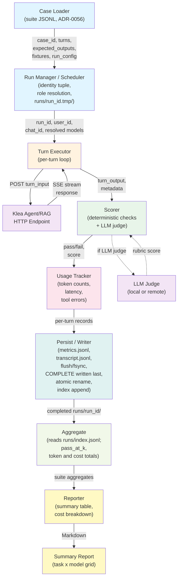
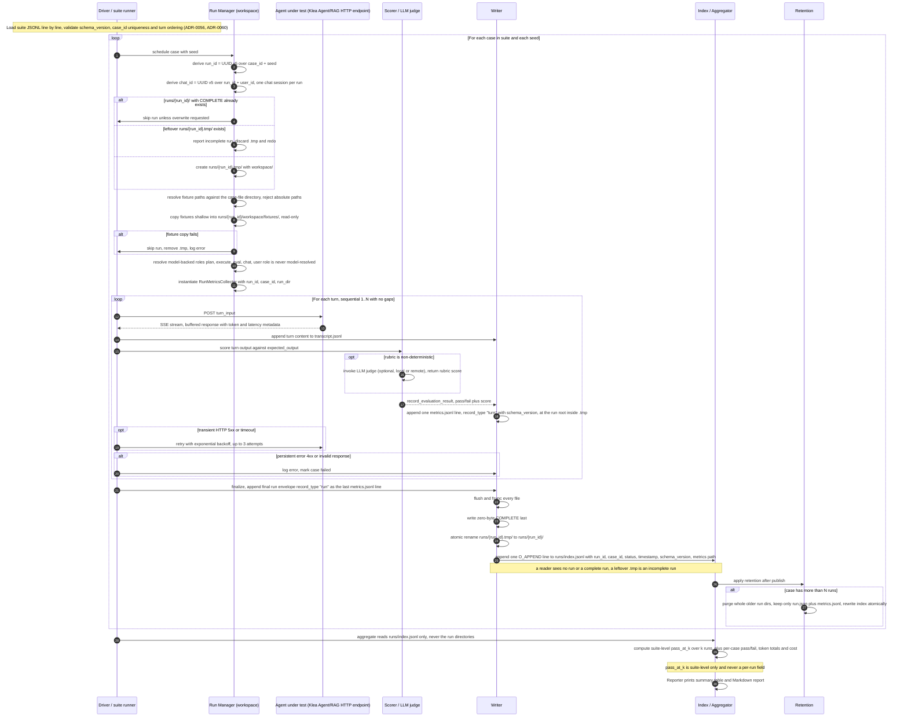

# Agent evaluation harness: planning note

Status: scope and orientation note, not an ADR.  It records the task
taxonomy, model conditions, threats to validity, the boundary guardrail
test and the `eval_pkg` layout; the normative decisions now live in
ADR-0056, ADR-0057, ADR-0058, ADR-0059 and ADR-0060, all dated 2026-10-27.
Companion to `agent-topology-literature-review.md`.  Written 2026-09-10 by
opencode (model: deepseek-flash).  The concrete `eval_pkg` implementation
plan is captured at the end of this document; it is deferred until the
general path stabilises.

## Why

The general-path topology must be chosen on evidence, and the scientific
write-up needs an evaluated comparison.  RAG was not evaluated this way; the
agent is harder because it carries out tasks rather than answering a single
query, so task success and cost are both first-class outcomes.  An evaluation
harness is therefore part of the architecture work, not an afterthought.

## Goals and non-goals

Goals:

- Compare candidate topologies (for example flat ReAct vs escalation ladder vs
  plan-first) on the same tasks, tools and models.
- Measure both correctness/task success and cost (tokens, LLM calls,
  wall-clock, notional money) under non-frontier models.
- Be reproducible and paper-ready: raw JSON plus generated summary tables.

Non-goals (first iteration):

- Full reproduction of GAIA/tau-bench/SWE-bench.  Start with a Klea-specific
  suite that mirrors their task shapes, and optionally add a public subset
  later.
- Multi-agent comparisons.  Out of scope per the literature review.

## What to measure

Per task run:

- task success (deterministic check where possible, LLM judge otherwise)
- pass@1 and pass^k over N repetitions (reliability)
- number of LLM calls, broken down by role
- input/output tokens and cache-read tokens (the node stream already surfaces
  `TokenUsage` via ADR-0013/0028)
- wall-clock time
- number of tool calls, tool errors and retries
- escalation events (structural vs model escalation; which tier handled the
  task)
- estimated cost from a per-model price table

## Task taxonomy

Mirror the failure modes in the literature:

1. Trivial chat (no tools) -- cost floor.
2. Single-tool action (read a file, run a command).
3. Multi-step coding (edit several files, run tests, iterate).
4. Tool-failure recovery (a tool errors; does the agent adapt?).
5. Misleading or under-specified task (does it ask, or guess?).
6. Long-horizon task that exceeds a context window (compaction behaviour).
7. Future: breadth-first research, the only case where multi-agent is
   justified.

Each task ships with a fixture workspace and an explicit success criterion.

## Models

Default condition: **one configured model** must run every topology.  The
general path must be fully functional single-model; multi-model is a separate,
optional condition (model escalation), never a requirement.

- A small local model via the existing ollama setup (CI already pulls
  `qwen3:0.6b`; `bge-m3` for embeddings).
- One mid-size local or hosted non-frontier model.
- Optional: a second model to exercise model escalation.
- Optional: a frontier model as a reference upper bound, clearly marked as
  not the target.

## Isolation and reproducibility

- Each run lives in its own directory `<eval_workspace_root>/runs/<run_id>/`,
  outside the source tree, containing `run.json`, `metrics.jsonl` at the run
  root (never under `workspace/`) and `transcript.jsonl`, with fixtures
  copied into `runs/<run_id>/workspace/fixtures/` and generated files under
  `runs/<run_id>/workspace/outputs/` (ADR-0057).  Case fixture paths resolve
  against the case-file directory, never the run workspace (ADR-0056).
- Tools sandboxed through the existing permission boundary.
- Temperature 0 and fixed seeds where possible; N repetitions to compute
  pass^k.
- Pin and record model versions and prompt versions in the result JSON.

## Integration

- Location to decide: a new dev-only package or a `scripts/` entry point.
- Reuse `scripts/run_tests.sh` conventions and a new pytest marker (for
  example `eval`) separate from `localonly`.
- Results: per-turn records appended to `run_dir/metrics.jsonl` inside
  `runs/<run_id>.tmp/` as the adopted protocol, not an optional extra, each
  object carrying `schema_version` and `record_type`, with the last line the
  `{run_id, case_id, schema_version, record_type, metrics{...}}` "run"
  envelope (ADR-0058); persistence precedes suite-level aggregation, which
  reads `runs/index.jsonl` (ADR-0059, ADR-0060).
- Topology variants wired as swappable graphs sharing prompts, tools and
  models, so the only independent variable is the topology.

## Boundary guardrail

The general path MAY use retrieval (RAG, web search, files) as an optional
tool, but MUST NOT enforce scientific-only stages.  The harness should assert
that the general-mode graph contains no mandatory retrieval/evidence
inspection/gating/independent verification/provenance, and include
retrieval-available tasks without requiring grounding.  This keeps general mode
from silently absorbing scientific complexity.

## Threats to validity

- LLM-judge bias: use rubrics, prefer deterministic checks, spot-check with
  humans.
- Non-determinism and small samples.
- Prompt sensitivity across topologies (keep prompts identical).
- Model version drift over time.

## Open questions

- Which tasks best represent the target academic general use?
- Which models should be the standard set?
- In-repo (pytest/scripts) or a standalone harness package?  (Resolved below:
  a new in-repo `eval_pkg`.)
- First iteration scope: the full taxonomy, or a minimal end-to-end slice?
- How to cost local models: wall-clock/energy, or a notional price table?

---

# eval_pkg implementation plan (deferred)

Status: deferred.  Do not implement until the general agent path has
stabilised (see `agent-general-path-control-flow.md`).  Recorded here so
the design is not lost.  The general `run_command` tool it needs (for
taxonomy items 2 and 3: single-tool action, multi-step coding) now exists
(ADR-0038, full-mode only).

## Decision

A new dev-only package `eval_pkg/` (import name `klea_eval`), living in the
monorepo alongside the runtime packages, rather than a `scripts/` entry
point or a standalone repository.  Rationale: the harness must import the
orchestrators and subclass them, be unit-testable without an LLM, and share
the existing `ty`/`ruff`/pytest conventions.

Direction of dependency: `eval_pkg` depends on `agent_pkg` and `rag_pkg`
(never the reverse).  It consumes them as installed packages, exactly as the
apps consume `klea_utils`.

## Layout

```
eval_pkg/
|-- pyproject.toml / setup.cfg     # package klea_eval; no runtime deps beyond the apps
|-- AGENTS.md                      # package-specific commands/conventions
|-- klea_eval/
|   |-- common/                    # app-agnostic harness core
|   |   |-- schemas.py             # TaskSpec, FixtureWorkspace, TaskResult, RunConfig
|   |   |-- fixtures.py            # run-directory and fixture creation under runs/<run_id>/workspace/fixtures/
|   |   |-- metrics.py             # per-turn metrics.jsonl records under the ADR-0058 schema
|   |   |-- scoring.py             # deterministic checks + LLM-judge rubric hook
|   |   |-- cost.py                # per-model notional price table
|   |   |-- runner.py              # N-repetition loop writing per-run records; pass_at_k is suite-level
|   |   `-- report.py              # summary table from the Aggregate stage
|   |-- agent/
|   |   |-- tasks/                 # task set mirroring the taxonomy, with fixtures
|   |   |-- variants.py            # topology variants (see below)
|   |   `-- run.py                 # agent-specific entry point
|   `-- rag/
|       |-- tasks/
|       `-- run.py
`-- tests/                         # harness unit tests (no LLM), marker `eval` for full runs
```

## Topology variants

Variants subclass the real orchestrator and override `_create_graph` only, so
prompts, tools and models are shared and the sole independent variable is the
topology:

- variant A: flat ReAct (experimental baseline);
- variant B: plan-first;
- variant E/F: the chosen escalation ladder, and a variant with/without a
  feature under test (for example reasoning steps, or the budgets).

A boundary guardrail test asserts the general-mode graph contains no
mandatory retrieval / evidence-inspection / gating / verification /
provenance nodes, and runs retrieval-available tasks without requiring
grounding (see the guardrail section above).

## Conventions and CI

- `ty.toml`: add `eval_pkg` to `extra-paths` so cross-package imports resolve.
- Tests: `cd eval_pkg && pytest -v` for the unit tests (no LLM); full eval
  runs are marked `eval` and require an explicit opt-in, never blocking CI.
- `scripts/run_tests.sh`: include the harness unit tests; do not run the full
  evaluation matrix.
- Results persisted as `runs/<run_id>/` with a versioned `metrics.jsonl`
  (`schema_version`, `record_type`, final "run" envelope); suite aggregates
  are read from `runs/index.jsonl` and the Markdown summary table is
  generated from those aggregates (ADR-0058, ADR-0059, ADR-0060).

## Deferred sub-items

- Public-benchmark subsets (GAIA/tau-bench/SWE-bench) after the Klea-specific
  suite is stable.
- Model-escalation condition (optional multi-model), clearly separated from
  the required single-model condition.
- Human spot-checks and rubric calibration for the LLM judge.

---

# Storage decision: filesystem-only results

Status: superseded by ADR-0059 (Result Storage); only the rationale for
rejecting an external tracking backend is retained here.

Results live under the evaluation workspace root: each run is stored as
`runs/<run_id>/` holding `run.json`, `metrics.jsonl` at the run root (never
under `workspace/`), `transcript.jsonl`, the `workspace/` directory and the
zero-byte `COMPLETE` marker, while a single suite-level `runs/index.jsonl` is a
lookup and listing entry point only and never an aggregation store.  No
database, server or tracking service is required or planned: standard
filesystem operations and JSON libraries suffice, and a run reproduces
offline from its own directory alone (ADR-0059).

## Rejected alternatives

An external experiment-tracking backend (MLflow, or RAGAS for retrieval
metrics) was rejected: it adds a service, credentials and availability failure
modes to every run, breaks local offline reproducibility, and its tracking or
RAG-centric schema does not fit the project-specific contracts already fixed
by ADR-0056 (case format), ADR-0057 (run identity) and ADR-0058 (metrics
schema).  A single monolithic results log, an embedded database and an
external database or object store were rejected for the same reasons: none of
them beats directory-per-run plus a JSONL index on durability, isolation,
debuggability with ordinary tools, and operation without infrastructure
(ADR-0059).

---

# Eval Harness Architecture Diagram

## System overview

The evaluation harness follows the six ADR-0060 stages -- Load, Schedule, Execute, Score, Persist, then Aggregate and report -- organized as a pipeline that persists every run before any suite-level aggregation.  External systems are limited to the Klea agent/RAG HTTP endpoint and the optional LLM judge.



## Run lifecycle sequence

This sequence diagram adds the time ordering that the stage graph above does not show: the per-run lifecycle from case load through execution, scoring, persistence and retention, followed by suite-level aggregation.



## Component responsibilities

### Case Loader
- **Input**: JSONL file with test cases (case_id, turns, expected_outputs, fixtures, tool_expectations, run_config).
- **Output**: Parsed case objects ready for execution.
- **Responsibility**: Validate case schema, resolve fixture paths, prepare run configuration overrides.

### Run Manager
- **Input**: Case object, model selection strategy.
- **Output**: Initialized run context: the identity tuple `(run_id, user_id, chat_id)`, the run directory `runs/<run_id>.tmp/` with its `workspace/`, and the resolved models.
- **Responsibility**: Derive `run_id` as UUID v5 over `case_id` + harness seed and `chat_id` as UUID v5 over `run_id` + `user_id` (one chat session per run); create the isolated run directory outside the source tree; copy case fixtures into `runs/<run_id>/workspace/fixtures/`; resolve the model-backed roles `plan`, `execute`, `eval` and `chat` from `role_model_map` and `run_config.model_overrides` (the `user` role is human input taken from the case and is never model-resolved); initialize the run's metrics collector.

### Turn Executor
- **Input**: Run context, turn specification (input, expected_output, tool_expectations).
- **Output**: Turn response (output, metadata, token usage, latency).
- **Responsibility**: POST turn input to Klea agent/RAG HTTP endpoint, stream SSE response, buffer complete response, handle errors and retries.

### Scorer
- **Input**: Turn output, expected output, scoring rules (deterministic checks or LLM rubric).
- **Output**: Pass/fail decision, score, reasoning.
- **Responsibility**: Apply deterministic checks (file existence, format validation), invoke LLM judge if needed, record per-turn pass/fail.

### Usage Tracker
- **Input**: Turn response metadata (token counts, model identity, latency, tool calls).
- **Output**: Per-turn usage record (input_tokens, cached_tokens, output_tokens, model, latency_ms, tool_error_count), emitted as a `metrics.jsonl` record carrying `schema_version` and `record_type` "turn".
- **Responsibility**: Extract token counts from response or DEBUG logs, aggregate per LLM call, track tool errors and retries; records are appended to `metrics.jsonl` at the run root, never under `workspace/`.

### Result Aggregator
- **Input**: Per-turn metrics and per-case pass/fail decisions for one run.
- **Output**: The versioned per-run envelope `{run_id, case_id, schema_version, record_type, metrics{...}}` with `task_success`, token totals and cost estimate.
- **Responsibility**: Aggregate the run's own records only; `pass_at_k` is a suite-level aggregate computed later by the Aggregate stage from `runs/index.jsonl`, so it is never a per-run field.

### Persistence (Writer)
- **Input**: A finished run: its `run.json` envelope, `metrics.jsonl` records, `transcript.jsonl` and `workspace/`.
- **Output**: The completed run directory `runs/<run_id>/` plus one appended line in `runs/index.jsonl`.
- **Responsibility**: Own the single write protocol: write into `runs/<run_id>.tmp/` as the run proceeds, flush and `fsync` every file, write the zero-byte `COMPLETE` marker last, rename the directory to `runs/<run_id>/` atomically, then append one `O_APPEND` line to `runs/index.jsonl`; apply retention by keeping the full run directory for the most recent N runs per case (N from run config) and only `run.json` plus `metrics.jsonl` for older runs; a leftover `.tmp` directory is unambiguously an incomplete run.

### Reporter
- **Input**: Suite aggregates from the Aggregate stage, read from `runs/index.jsonl`.
- **Output**: Summary table (task x model grid), cost breakdown, Markdown report.
- **Responsibility**: Generate human-readable summary tables, compute cost per task/model, produce write-up-ready output.

## Data flow

1. **Load**: suite JSONL -> Case objects (case_id, turns, expected_outputs, fixtures, run_config).
2. **Schedule**: Case + model selection -> Run context: the identity tuple `(run_id, user_id, chat_id)` with `run_id` = UUID v5 over `case_id` + seed and `chat_id` = UUID v5 over `run_id` + `user_id`, the resolved models, and `runs/<run_id>.tmp/` with its `workspace/`.
3. **Execute**: Turn input -> HTTP POST -> SSE stream -> buffered response; turn content is appended to `transcript.jsonl` and per-turn records to `metrics.jsonl`.
4. **Score**: Turn output + expected output -> Scorer -> pass/fail + score, recorded through the metrics collector.
5. **Usage tracking**: Response metadata -> Usage tracker -> per-turn `metrics.jsonl` record (tokens, latency, tool errors).
6. **Persist**: Buffered records -> `runs/<run_id>.tmp/`; flush and `fsync`, `COMPLETE` written last, atomic rename to `runs/<run_id>/`, then one `O_APPEND` line to `runs/index.jsonl`.
7. **Aggregate**: `runs/index.jsonl` -> suite-level `pass_at_k`, per-case pass/fail, token totals and cost.
8. **Report**: Suite aggregates -> Reporter -> summary table + Markdown.

## External integrations

### Klea Agent/RAG HTTP Endpoint
- **Protocol**: HTTP POST with SSE streaming response.
- **Input**: Turn input (user message, context, tool availability).
- **Output**: SSE stream with response chunks, metadata (token usage, model, latency).
- **Error handling**: Retry logic on transient errors; case skip on persistent failures.

### LLM Judge (optional)
- **Protocol**: HTTP API (OpenAI-compatible, Ollama, or local).
- **Input**: Turn output, expected output, rubric.
- **Output**: Score, reasoning.
- **Integration**: Invoked by Scorer for non-deterministic tasks; configurable per task.

## Error handling and retry logic

- **Transient errors** (HTTP 5xx, timeout): Retry with exponential backoff (up to 3 attempts).
- **Persistent errors** (HTTP 4xx, invalid response): Log error, skip case, record failure reason.
- **Scoring errors** (LLM judge unavailable): Fall back to deterministic check or mark as inconclusive.
- **Workspace errors** (fixture copy into `runs/<run_id>.tmp/workspace/fixtures/` failed): Skip run, remove the `.tmp` directory, log error.
- **Incomplete runs**: A leftover `runs/<run_id>.tmp/` directory is reported as an incomplete run and is never treated as a result; a re-run discards and redoes it.

## Reproducibility guarantees

- **Seed pinning**: Fixed random seed per run (logged in `run.json`).
- **Model versioning**: Model name, version and parameters logged in `run.json`.
- **Prompt versioning**: Prompt text and version logged in `run.json`.
- **Fixture snapshots**: Fixtures copied under `runs/<run_id>/workspace/`; the original fixture is preserved and the copy is immutable.
- **Artifact storage**: `run.json` plus the versioned `metrics.jsonl` (`schema_version`, `record_type`, final "run" envelope), `transcript.jsonl` and the workspace are stored for offline reproducibility.
- **Retention**: The full run directory is kept for the most recent N runs per case (N from run config); older runs keep only `run.json` plus `metrics.jsonl` (ADR-0059).
- **Scope of determinism**: Only identifiers, ordering and derived metrics are reproducible; turn content and latency are stochastic.

---

# Open Questions and Design Decisions

Status: questions 1, 3, 4 and 5 are settled by ADR-0056, ADR-0057, ADR-0058, ADR-0059 and ADR-0060 and are kept below only as a record of the decision plus its ADR reference; only the genuinely open items remain open.

## 1. Multi-turn execution: sequential or parallel?

**Resolved by ADR-0057**: one run is exactly one chat session, fixed at run initialization.

**Context**: Test cases may contain multiple turns (e.g., a multi-step coding task with 3 turns: initial request, feedback on error, refinement). The harness must decide whether to execute turns sequentially within a single run or in parallel across multiple runs.

**Options**:
- **Sequential (within-run)**: All turns execute in one run context -- one `run_id`, one `chat_id`, one workspace. Turns are executed one after another; each turn sees the results of previous turns (e.g., file edits persist). This mirrors a real conversation.
- **Parallel (across runs)**: Each turn would execute in a separate run context with its own workspace copy. Turns are independent; no state carries over. Because a run is always exactly one chat session (ADR-0057), this mode would create several runs for one case and is deferred.

**Implications**:
- **Sequential**: Simpler state management, realistic conversation flow, but a single turn failure may cascade. Harder to parallelize for speed.
- **Parallel**: Better isolation and parallelization, but requires explicit state passing between turns (e.g., file edits from turn 1 must be replayed in turn 2's workspace). More complex setup.

**Decision**: Sequential within one run is the default, and it is what ADR-0057 fixes: one `run_id`, one `chat_id` and one workspace per run, with later turns seeing the earlier turns' file edits. A per-case `execution_mode` override remains a deferred extension.

## 2. Error handling: retry, skip, or fail?

**Context**: Errors can occur at multiple levels: HTTP errors from the endpoint, invalid response format, tool failures, or scoring failures. The harness must decide how to handle each error type.

**Options**:
- **Retry with backoff**: Transient errors (HTTP 5xx, timeout) trigger exponential backoff (e.g., 3 attempts). Persistent errors (HTTP 4xx, invalid response) are logged and the case is skipped.
- **Skip case**: Any error causes the case to be skipped; no retry. Faster feedback but may miss transient issues.
- **Fail run**: Any error causes the entire run to fail; no partial results. Strictest but may block evaluation on a single bad case.

**Implications**:
- **Retry**: Handles transient failures gracefully; more robust. Adds latency and complexity.
- **Skip**: Fast feedback; partial results are still useful. May hide real issues.
- **Fail**: Strictest; forces investigation. May be too strict for large evaluation suites.

**Recommendation for ADR**: Implement retry for transient errors (HTTP 5xx, timeout) with exponential backoff (3 attempts, 1s/2s/4s). Skip case on persistent errors (HTTP 4xx, invalid response). Log all errors for post-run analysis. Allow per-case override via `error_handling` in run_config.

## 3. Model selection: per-run or per-turn override?

**Resolved by ADR-0057**: model resolution is eager and per-run.

**Context**: The harness must support model selection for topology comparison. The question is whether model selection is fixed per run (all turns use the same model) or can vary per turn (e.g., escalation to a stronger model mid-conversation).

**Options**:
- **Per-run**: Model is selected once at run initialization via the run_config role -> model map. All turns use the same model. Simpler, aligns with the "single-model default" in the original design.
- **Per-turn**: Model can be overridden per turn via turn-level run_config. Allows mid-conversation escalation. More complex but enables model-escalation evaluation.

**Implications**:
- **Per-run**: Simpler implementation, aligns with the single-model default. Does not support model escalation in the MVP.
- **Per-turn**: Enables model escalation evaluation (optional condition). Requires turn-level model resolution and separate token tracking per model.

**Decision**: Per-run resolution is the default and is fixed by ADR-0057: the model-backed roles `plan`, `execute`, `eval` and `chat` are resolved eagerly from `role_model_map` and `run_config.model_overrides`, while `user` is human input taken from the case and is never model-resolved.  A per-turn override remains a future, optional model-escalation condition and is not part of the MVP.

## 4. Usage tracking: aggregate at run end or stream per-turn?

**Resolved by ADR-0058 and ADR-0059**: per-turn streaming into `run_dir/metrics.jsonl` is the adopted protocol, not an optional extra.

**Context**: Token counts, latency, and tool errors must be tracked for each turn. The question is whether to aggregate metrics at the end of the run or stream them per-turn.

**Options**:
- **Aggregate at run end**: Collect per-turn metrics in memory; write the aggregated document at run end. Simpler, but loses per-turn granularity if the run crashes.
- **Stream per-turn**: Write per-turn records to `metrics.jsonl` at the run root as the run proceeds. More robust to crashes; enables real-time monitoring.

**Implications**:
- **Aggregate**: Simpler implementation, cleaner document. Risk of data loss on crash.
- **Stream**: More robust, enables real-time monitoring. Requires append-only JSONL writing.

**Decision**: Per-turn records are appended to `run_dir/metrics.jsonl` (at the run root, never under `workspace/`) inside `runs/<run_id>.tmp/` while the run executes, each carrying `schema_version` and `record_type`, so they are already durable if the run crashes; the last line is the `{run_id, case_id, schema_version, record_type, metrics{...}}` "run" envelope.  Per-run aggregation therefore happens over records that are already on disk.

## 5. Result persistence: JSON file, external backend, or both?

**Resolved by ADR-0059**: filesystem-only, with an append-only JSONL index.

**Context**: Results must be persisted for reproducibility and reporting. The question is where the authoritative record lives and whether an external tracking backend is needed.

**Options**:
- **JSON file only**: Write run records to JSON files in a local directory. No external service required. Reproducible offline. Harder to query across runs.
- **External tracking backend only**: Log all runs to a tracking service. Centralized, queryable, UI for run comparison. Requires a service; harder to reproduce offline.
- **Both**: Write JSON files as the primary artifact and optionally log to the backend. Flexible, but adds complexity and a sync problem.

**Implications**:
- **JSON only**: Simple, reproducible, no external dependency. Harder to query and compare runs.
- **External backend**: Centralized, queryable, nice UI. Requires external service; harder to reproduce offline.
- **Both**: Flexible, reproducible, queryable. Adds complexity; requires careful sync between the files and the backend.

**Decision**: Filesystem-only per ADR-0059.  Each completed run is a self-contained `runs/<run_id>/` directory holding a versioned `run.json` and `metrics.jsonl`, and a single suite-level `runs/index.jsonl` is a lookup and listing entry point only; no database, server or service is required, and no MLflow or RAGAS tracking is adopted or planned.  An external tracking backend was rejected because it breaks local offline reproducibility and adds service, credential and availability failure modes to every run.

## 6. Scoring latency: synchronous or async judges?

**Context**: Scoring may involve LLM judges (for non-deterministic tasks) or external services (e.g., RAGAS metrics). The question is whether to invoke judges synchronously (block until score is ready) or asynchronously (collect scores later).

**Options**:
- **Synchronous**: Invoke LLM judge immediately after each turn; block until score is ready. Simpler, but adds latency (LLM call per turn).
- **Asynchronous**: Collect turn outputs; invoke judges in batch after all turns complete. Faster per-turn execution; can parallelize judge calls. More complex; requires careful state management.

**Implications**:
- **Synchronous**: Simpler implementation, immediate feedback. Adds latency per turn (LLM call latency).
- **Asynchronous**: Faster per-turn execution, can parallelize judges. More complex; requires batch collection and state management.

**Recommendation for ADR**: Default to synchronous judges (simpler for MVP). Optionally support batch/async judges for large evaluation suites (Phase 3 or later). Document the extension point in the scorer architecture.

## Summary of recommendations for MVP

1. **Multi-turn execution**: Sequential within a single run -- one `run_id`, one `chat_id`, one workspace (ADR-0057).
2. **Error handling**: Retry transient errors (3 attempts); skip case on persistent errors.
3. **Model selection**: Per-run, over the model-backed roles `plan`, `execute`, `eval` and `chat`; `user` is never model-resolved (ADR-0057).
4. **Usage tracking**: Per-turn records streamed into `run_dir/metrics.jsonl` as the adopted protocol (ADR-0058, ADR-0059).
5. **Result persistence**: Filesystem-only per ADR-0059 -- versioned `run.json` plus `metrics.jsonl` under `runs/<run_id>/`, with `runs/index.jsonl` as a lookup-only index.
6. **Scoring latency**: Synchronous judges (simpler).

These decisions are recorded in ADR-0056, ADR-0057, ADR-0058, ADR-0059 and ADR-0060.  The genuinely open items above, and the deferred extensions such as parallel turns, per-turn model selection, async judges and an external tracking backend, can be revisited as the harness matures.
