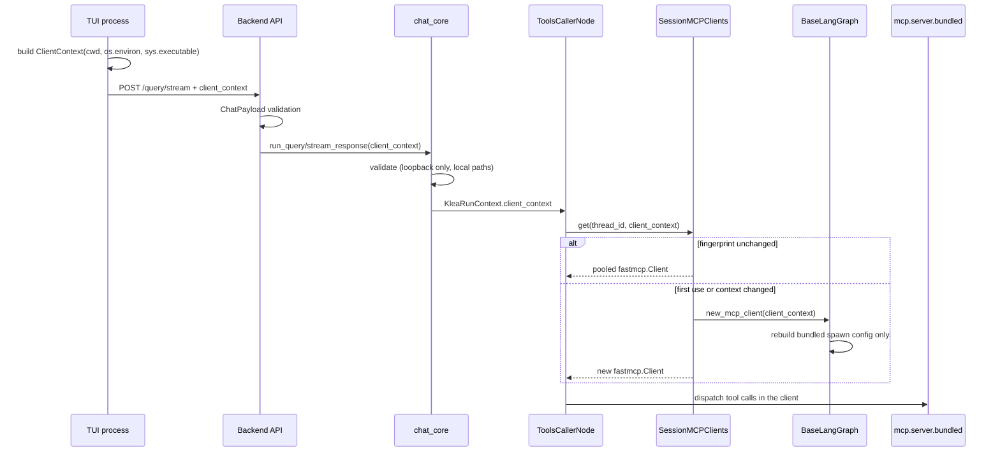

# Runtime client MCP context

How a chat's bundled MCP server gets the environment of the frontend that is
driving it.  This is runtime context, not session state: it is sent with each
query and is never stored in the checkpoint or session database.

See ADR-0055 and ADR-0023 (one backend per storage root).

## Data flow



## Wire shape

The TUI merges this into the existing request-extra channel:

```json
{
  "query": "list the files",
  "chat_id": "calm-river",
  "user_id": "...",
  "client_context": {
    "cwd": "/home/user/project",
    "interpreter": "/home/user/project/.venv/bin/python",
    "env": {"VIRTUAL_ENV": "/home/user/project/.venv", "PROJECT_ENV": "dev"}
  }
}
```

## TUI builder

`utils_pkg/klea_utils/ui/cli.py:_build_client_context`:

* defaults: `os.getcwd()`, the whole `os.environ`, and `sys.executable`;
* `--cwd PATH`, repeatable `--env KEY=VALUE` (later wins), and
  `--interpreter PATH` override the defaults;
* `--no-client-context` disables forwarding;
* a non-loopback server URL disables forwarding with a note: a remote backend
  cannot use the client's paths or interpreter, and remote work should use a
  backend on that machine (or the TUI over SSH).

The context is attached to every stream call, so a retry or HITL resume after
a failure uses the current TUI environment.

## Server validation

`klea_utils.client_context.validate_client_context`:

* loopback peer only (`request.client.host`), else `ClientContextError` with
  HTTP 403;
* `cwd` absolute, existing, a directory, readable/executable; symlinks are
  resolved;
* `interpreter` absolute, existing, executable; symlinks are resolved;
* `env` at most 256 variables and 64 KiB serialised; names non-empty and
  without `=`/NUL; values without NUL; malformed input is HTTP 400;
* rejected rather than trimmed, so a frontend never believes isolation is
  active when it is not.

`chat_core` puts the validated model in `KleaRunContext.client_context`
(`model_dump()`), never in `extra_state`.  Debug logging reduces it to
`cwd`/`interpreter`/env-key count; environment values are never logged.

## Spawn and pooling

`BaseLangGraph.new_mcp_client(client_context)`:

* rebuilds only the `bundled` entry with
  `spawn.bundled_server_config(env=..., cwd=..., interpreter=...)`;
* external MCP servers keep their configured command/URL;
* the spawn helper strips `VIRTUAL_ENV`/`PYTHONHOME`/`PYTHONPATH` from the
  inherited environment and then merges the client's environment on top, so
  the client's values win.

`SessionMCPClients.get(session_id, client_context)` stores a stable
fingerprint (cwd + interpreter + sorted env).  A matching fingerprint reuses
the pooled client; a mismatch closes it and creates a new one.  Pool logs
include the cwd, interpreter, env-key count, and a short fingerprint, never
environment values.

## Project root fallback

When `BaseGraphSchema.project_root` is empty:

* `ToolsCallerNode` uses `client_context.cwd` for relative-path resolution and
  as the permission boundary;
* `InitGraphState` reads `AGENTS.md`/`CLAUDE.md` from it;
* the agent TUI's project-root row displays it.

An explicit `/cwd` always wins.  The fallback is not written back to state, so
relaunching the TUI in another directory is followed on the next turn.

## Failure modes

| Symptom | Cause | Behaviour |
|---------|-------|-----------|
| 403 `client context is only accepted from loopback peers` | Context sent to a remote backend | TUI normally skips; a hand-built request is rejected |
| 400 `client context cwd ...` | Stale/relative/missing client path | Request rejected before the graph runs |
| Spawn failure after a TUI relaunch | Interpreter path missing on the backend host | Tool call fails; a new chat/TUI with a valid context recovers |
| Tool server respawns between turns | Two TUIs with different contexts drive the same chat | Expected: the runtime environment follows the current frontend |

## Code and tests

* `utils_pkg/klea_utils/client_context.py` -- model, validation, fingerprint.
* `utils_pkg/klea_utils/api/chat_core.py` -- request boundary and runtime
  context.
* `utils_pkg/klea_utils/mcp/session_pool.py` -- fingerprint respawn.
* `utils_pkg/klea_utils/graph/base.py` -- bundled-only spawn rebuild.
* `utils_pkg/klea_utils/nodes/tools_caller.py` -- runtime read and project-root
  fallback.
* Tests: `test_client_context.py`, `test_mcp_session_pool.py`,
  `test_bundled_config.py`, `test_chat_core.py`, `test_nodes_tools_caller.py`,
  `test_client_cli.py`, `tests/ui/tui/test_app.py`, and the agent
  `test_init_graph.py`/`test_tui_project_root_ui.py`.
