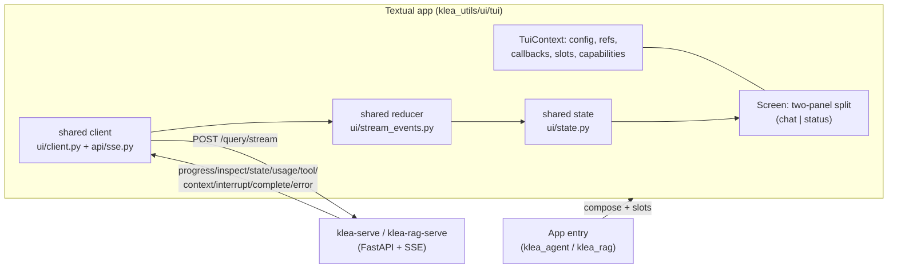

# Terminal UI: architecture and component contract

Status: in progress (ADR-0050).  This note is the companion to ADR-0050 and
governs the shared Textual client in `utils_pkg/klea_utils/ui/tui/` and the
per-app entries.  The TUI is an SSE consumer of the same `/query/stream`
endpoint the web client uses, so the event payloads are unchanged
(`system/streams.md`); this note covers only how the terminal frontend is
built and what it must preserve.  The shared `App`/`Screen` two-panel
skeleton, the thin per-app entries, the single run worker (basic
`progress`/`complete` streaming, turn-status states, and Stop/Retry), the
MIME-aware transcript and the inspector view have landed (Phase 2.2-3.2);
the status pane, session commands, HITL and session management are still to
come.

## Overview

The TUI is a full-screen Textual application launched **in-process** by a new
`tui` subcommand (unlike the NiceGUI web client, which runs as a subprocess).
It connects to a running `klea-agent-serve` / `klea-rag-serve` over HTTP/SSE
and renders **one active session at a time**, with a summonable picker to
switch or resume.  It is a thin client (ADR-0026): the server owns sessions,
checkpoints and graph state; the TUI holds a hydrated projection (`ChatData`)
that it may discard and reload at any time.

Data flow:



## Layout

The screen is a horizontal split into exactly two full-height panels, like the
web page's chat column plus its right drawer:

* **Chat panel** (left, full height): the app title and server line, a view
  toggle between the transcript and the inspector, the turn-status line, the
  input, and the keybinding hints.
* **Status panel** (right, full height): the operating-mode / tool-access
  selectors, the resolved models, the streamed state sections, and token
  usage.

Because the status panel spans the full height, there is no separate
full-width header or footer bar; the title/keys live inside the chat panel.

```
+---------------------------------------------+----------------------+
| chat panel                                  | status panel         |
|  title: <app> | <server>                    | (full height)        |
| ------------------------------------------- |                      |
|  [ transcript | inspect ]  <- view toggle   |  mode / access       |
|  ...messages...                             |  models              |
|                                             |  state sections      |
| ------------------------------------------- |  token usage         |
|  turn status: spinner | error+Retry | ...   |                      |
|  input (> ...)                   [Send/Stop]|                      |
|  keys: Enter send | Ctrl+C stop | Ctrl+S ...|                      |
+---------------------------------------------+----------------------+
```

## Component contract

Shared widgets live in `klea_utils/ui/tui/` with no app imports (invariant
I8); each app composes its own screen from them, mirroring the NiceGUI
`components/` split (ADR-0031).

| Component | Planned module | Responsibility | Web counterpart |
|-----------|----------------|----------------|-----------------|
| App + Screen | `ui/tui/app.py` | Textual `App`, keybindings, the single run worker | `components/bootstrap.py` + `page.py` |
| TuiContext | `ui/tui/context.py` | Config, element refs, cross-component callbacks, app slots, capabilities | `components/context.py` (`PageContext`) |
| Transcript | `ui/tui/components/transcript.py` | Message widgets, MIME-aware rendering | `chat_area.py` + `chat_bubble.py` |
| Input | `ui/tui/components/input.py` | Query entry, send/stop routing, `/` completion | `input_area.py` |
| Turn status | `ui/tui/components/turn_status.py` | Live heading, error+Retry, stopped, awaiting input | chat-area turn-status region |
| Status panel | `ui/tui/components/status_panel.py` | Full-height right panel: mode/access, models, state sections, token usage | `status_pane.py` |
| Inspector view | `ui/tui/components/inspector.py` | Inspect entries; a toggle view inside the chat panel | `inspector.py` |
| Session picker | `ui/tui/components/sessions.py` | `ModalScreen` list / switch / rename / delete | `chat_list.py` |
| HITL | `ui/tui/components/hitl.py` | Review / input / permission modals | `choice.py` + status-region form |
| Commands | `ui/tui/components/commands.py` | Merged catalogue, dispatch, `/` autocomplete | `components/commands.py` |
| Shared state | `ui/state.py` | `ChatData` store + helpers | `web/nicegui/state.py` (moved) |
| Reducer | `ui/stream_events.py` | `apply_stream_event` | `web/nicegui/components/stream.py` (extracted) |
| Client | `ui/client.py` | Sessions, models, credentials, commands (`GET`/`POST`) | `web/nicegui/client.py` (moved) |

The three shared modules are extracted in Phase 1 so the web and TUI share one
source of truth for the event contract; NiceGUI-only drivers (`run_stream`,
`stop_stream`) stay in the web package.

## Event consumption

The event catalogue and payload shapes are fixed by `system/streams.md`; the
TUI must not reinterpret them.  Per event:

| Event | TUI behaviour | Web counterpart |
|-------|---------------|-----------------|
| `progress` | Update the turn-status heading in place (no full re-render) | spinner label |
| `ping` | Ignored (keeps the SSE alive) | ignored |
| `inspect` | Append an entry to the inspector view (chat-panel toggle; `format_details` for `details`) | inspection pane |
| `state` | Update a status-panel section keyed by `data.key` or node label | status pane |
| `usage` | Accumulate token totals in the status panel | token totals |
| `tool` | Append a message widget (MIME-aware, text fallback) | chat blocks |
| `token` | Not consumed (no live typing; see streams.md) | ignored |
| `context` | Store on the active chat; reconcile the status-panel mode/access slots | status pane + `context_hooks` |
| `interrupt` | Open the HITL / permission modal; stop streaming until answered | chat ask form |
| `complete` | Append the agent message; set turn status idle | chat bubble |
| `error` | Turn status error; offer Retry when `resumable` | notification |

## Run model and invariants

One run is in flight at a time and is always attached to the active session
(ADR-0050, I1/I2).  A query starts the run worker; the worker drives
`stream_events`, feeds the shared reducer, and posts a message per event so
widgets refresh on the app loop.  Stop cancels the worker and best-effort
`POST /query/cancel`.  A failure `resume` re-runs with `resume=True`; a HITL
answer/cancel re-runs with `interrupt_response` / `interrupt_cancel` (I6).
Switching sessions is refused while a run is streaming.

The ADR-0050 invariants are the fitness function; this note adds the concrete
enforcement point for each:

| Invariant | Enforced by |
|-----------|-------------|
| I1 one run, attached | A single app-level run slot; the input worker is exclusive |
| I2 switch gated by run | The picker checks the run slot and refuses with a "Stop first" hint |
| I3 one reducer | The TUI imports `ui/stream_events.py`; no local event mapping |
| I4 thin client | Imports only `api/sse.py` + `ui/client.py`; rehydrate on load |
| I5 client-local identity | `resolve_user_id()` seam; local UUID sent only to loopback |
| I6 HITL is a pause | Answer/cancel goes through the same run, one action per request |
| I7 text fallback | The transcript renders `display` whenever a MIME is unrenderable |
| I8 app-agnostic shared code | No app import under `ui/tui/`; app controls via slots |

## Session model

* A keyed `{user_id}:{chat_id}` store with a single **active pointer**; the
  active session's messages and context are hydrated on create/switch/load,
  the picker lists only server metadata (`GET /chat/{user_id}`).
* Create mints a chat id (coolname slug) and `POST`s it; `--continue` resumes
  the most recently updated session and `--resume <chat_id>` loads one.
* `user_id` resolves through one seam: `--user-id` > `KLEA_USER_ID` > a
  persisted TUI-local UUID (I5).  Sharing an identity with the web is a
  deferred design (backlog), not part of the TUI.

## Commands (ADR-0047)

The TUI reuses `klea_utils/commands/common.py`: it validates `/`-input against
the merge of its client commands and the server catalogue (`GET /commands`),
runs client commands locally (`/help`, and later `/new`, `/sessions`,
`/rename`, `/export`), and forwards server commands (`/mode`, `/access`) as
the query.  The `/`-autocomplete is a Textual completion/suggestion list over
the merged catalogue.  TUI capabilities start empty (no browser file picker);
local-filesystem/shell capabilities are deferred with the session-workspace
work and are not needed for parity.

## HITL and permissions

HITL asks render as `ModalScreen`s (review: approve / request changes /
cancel; input: one answer per question; permission: allow-once / allow-session
/ deny per requested path, ADR-0007).  Decisions are shown in the transcript
via `klea_utils/api/hitl.py:render_interrupt_response` so live and reloaded
text cannot drift.  A pending interrupt is re-presented on load/switch from
`GET /chat/{user_id}/{chat_id}/context` (`pending_interrupt`), matching the web
(ADR-0046).

## App composition

`klea_agent/ui/tui/` composes the shared screen and registers the operating
mode and tool-access selector slots (ADR-0030/0037); `klea_rag/ui/tui/`
registers none.  Both entries are thin (`run_agent_tui` / `run_rag_tui`,
mirroring `run_agent_web`) and pass only the title/prefix/app-name and page
builder.

## Rendering and non-goals

* Markdown renders through Rich; diffs (`text/x-diff`, `text/x-patch`) and
  code (`text/x-<lang>`) render with syntax highlighting.  MIME selection
  mirrors the web's `chat_bubble` rules.
* **Non-goals / known divergence**: no inline media (text fallback, ADR-0040);
  HTML tables/alerts degrade to plain renderables; no live token typing
  (`token` stays unconsumed, streams.md); no always-visible session sidebar.

## Testing

Textual's in-process `run_test()` pilot drives the real app against a canned
fake backend, mirroring the web UI tests (`system/web-ui-testing.md`); the
shared state and reducer have framework-agnostic unit tests.  The harness is
described in `system/tui-testing.md` when it lands.

## Pointers

* Decision: `adr/0050-textual-tui.md`.
* Events and payloads: `system/streams.md`, `system/api-sse-sequence.md`
  (ADR-0040, ADR-0013).
* Reused contracts: `api/sse.py` (SSE client), `commands/common.py`
  (ADR-0047), `api/hitl.py` (`render_interrupt_response`, ADR-0046),
  `ui/inspect_format.py` (`format_details`).
* Related: ADR-0026 (client-server), ADR-0031 (apps own UI composition),
  ADR-0043 (single active run per thread), ADR-0007 (path permissions),
  ADR-0030/0037 (mode / access).
* Code (planned): `utils_pkg/klea_utils/ui/{state,stream_events,client}.py`,
  `utils_pkg/klea_utils/ui/tui/`, `agent_pkg/klea_agent/ui/tui/`,
  `rag_pkg/klea_rag/ui/tui/`.
* Web counterparts: `ui/web/nicegui/{state.py,client.py,components/*}`.
